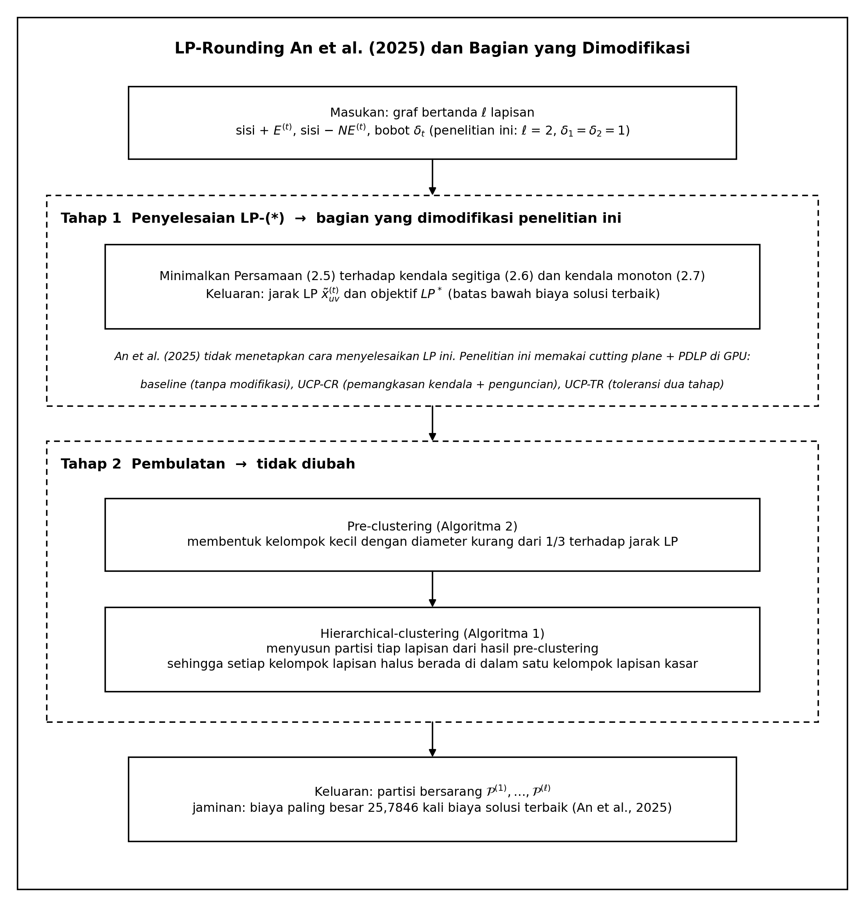
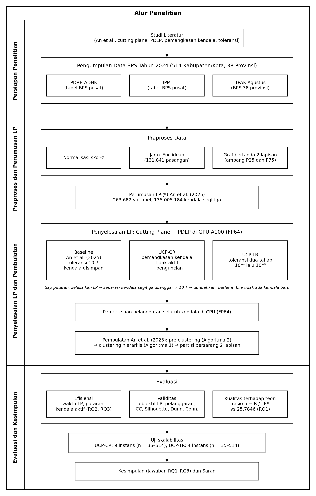
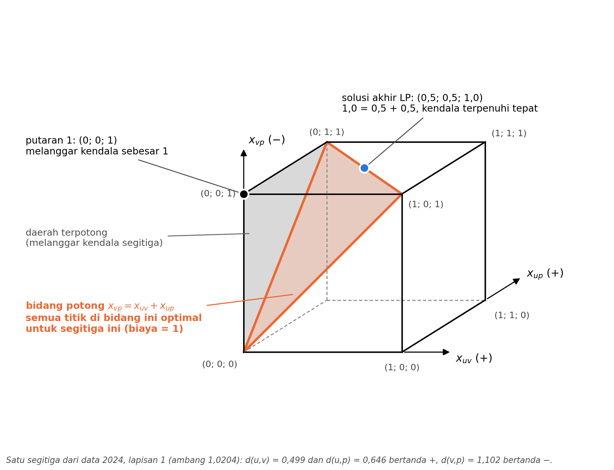
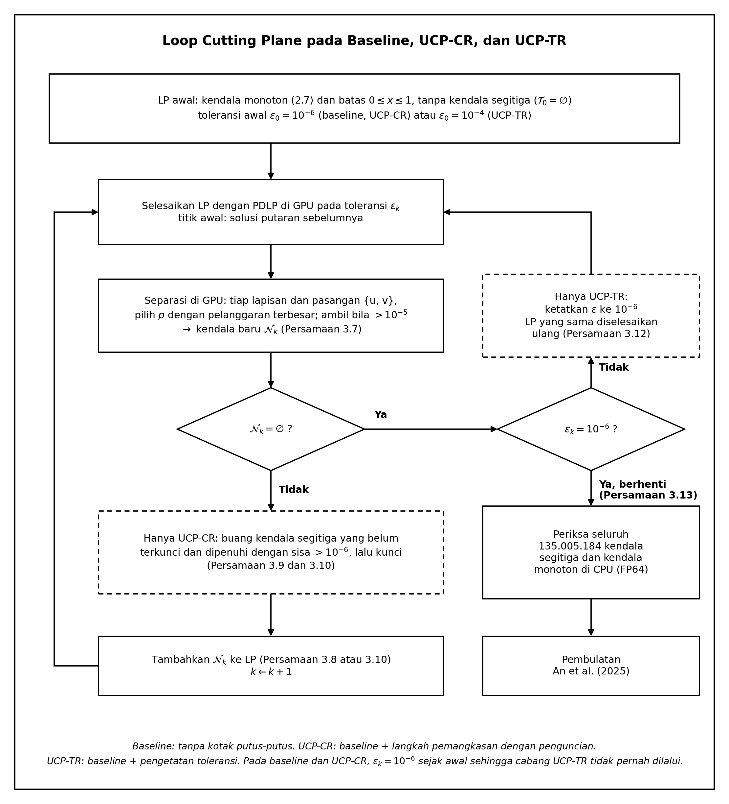
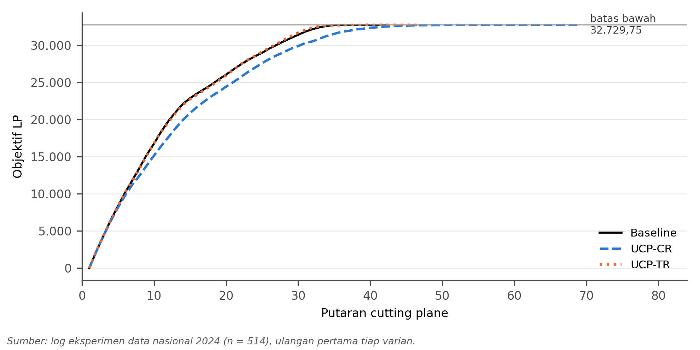
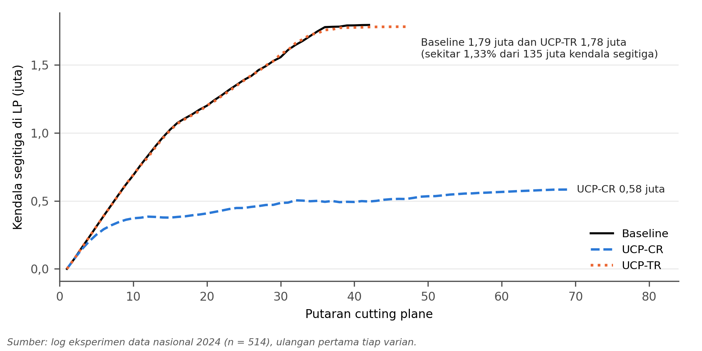
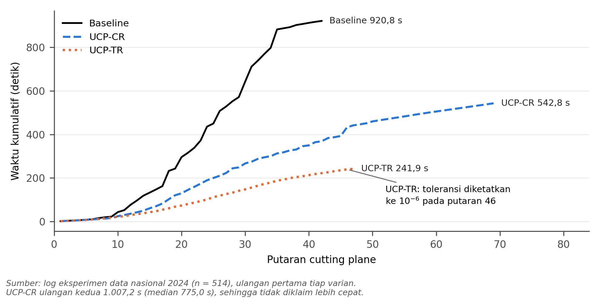
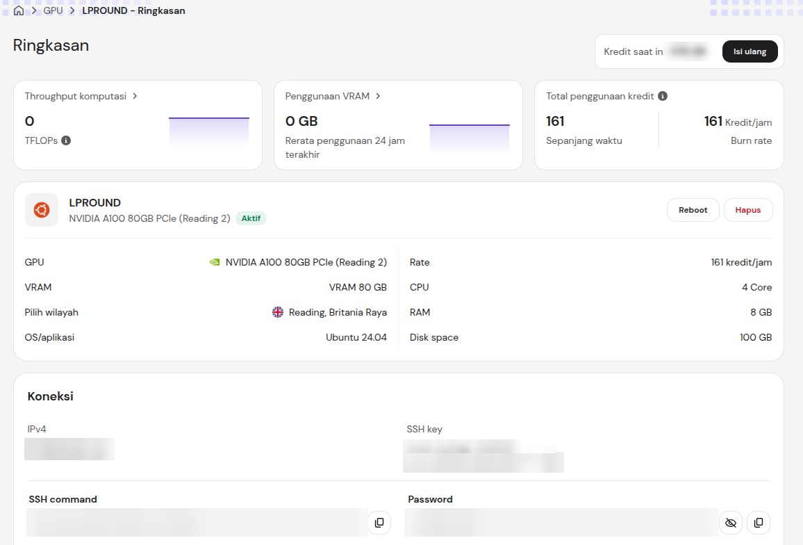

# UCP-CR and UCP-TR: Efficient LP-Rounding for *Hierarchical Correlation Clustering* on 514 Indonesian Regencies and Cities

[Bahasa Indonesia](README.id.md) | **English**

This repository contains the dataset, code, experimental results, and figures of the thesis *Improving the Efficiency of LP-Rounding Hierarchical Correlation Clustering Using Ultrametric Cutting Plane with Constraint Reduction and Time Reduction on 514 Regencies/Cities in Indonesia in 2024* (original title in Indonesian: *Peningkatan Efisiensi LP-Rounding Hierarchical Correlation Clustering Menggunakan Ultrametric Cutting Plane dengan Constraint Reduction dan Time Reduction pada 514 Kabupaten/Kota di Indonesia Tahun 2024*).

**In short:** this research applies the LP-Rounding clustering algorithm of An et al. (2025), which was only analysed theoretically in its publication, to real data on every regency and city in Indonesia. It then proposes two ways to make the LP inside that algorithm smaller (UCP-CR) and faster to solve (UCP-TR) without changing the LP objective.

**Hardware:** one NVIDIA A100 80 GB PCIe GPU (rented from Hostinger, Reading, United Kingdom) with a 4-core quota on an AMD EPYC 7713P CPU and 8 GB of RAM. Details are in [Server specification](#server-specification).

The figures in `figures/` use Indonesian labels, as they appear in the thesis.

## Background

Development across Indonesian regencies and cities is uneven, and a region cannot be described by a single indicator. This research uses three 2024 indicators from Statistics Indonesia (BPS) for 514 regencies and cities: gross regional domestic product at constant prices (PDRB ADHK), the Human Development Index (IPM), and the labour force participation rate (TPAK).

The grouping is done with *hierarchical correlation clustering* (HCC). Every pair of regencies/cities is labelled similar (+) or dissimilar (−), and the goal is a nested grouping that violates as few labels as possible. The output has two layers, a fine layer and a coarse layer, with every fine cluster inside one coarse cluster.

An et al. (2025) proved that their LP-Rounding algorithm for HCC costs at most 25.7846 times the best solution, but their work is purely theoretical. The main obstacle is the size of the LP. For 514 regencies/cities and two layers, the LP has 263,682 variables and 135,005,184 triangle constraints.

## What is studied

The LP-Rounding algorithm of An et al. (2025) has two stages. The first stage solves the LP relaxation LP-(\*), and the second stage rounds the solution with *pre-clustering* (Algorithm 2) and hierarchical clustering (Algorithm 1). An et al. (2025) do not specify how to solve LP-(\*), and this is the stage this research works on.



- **Baseline:** the LP-Rounding algorithm of An et al. (2025) on the same dataset. Its LP is solved with a standard cutting plane method (Grötschel and Wakabayashi, 1989) and PDLP on the GPU, without modification.
- **UCP-CR** (*Ultrametric Cutting Plane with Constraint Reduction*): removes inactive triangle constraints before the LP is solved again, and locks every removed constraint so that each constraint is removed at most once.
- **UCP-TR** (*Ultrametric Cutting Plane with Time Reduction*): solves the LP with tolerance 10⁻⁴ until no new constraint is found, then finishes at 10⁻⁶.

UCP-CR and UCP-TR only change how the LP is solved. The rounding stage of An et al. is used without changes. This research studies the efficiency of solving the LP; it does not compare the clustering quality of different algorithms.

The three research questions are:

1. How can the LP-Rounding algorithm of An et al. (2025) be applied to 514 regencies/cities, and how far is its cost from the theoretical bound?
2. Can the LP be made smaller without changing the LP objective? (UCP-CR)
3. Can the LP be solved faster without changing the LP objective? (UCP-TR)

## Research workflow



1. **Data:** 2024 GRDP, HDI, and labour force participation rate for 514 regencies/cities from BPS.
2. **Preprocessing:** the three variables are standardised with z-scores, then Euclidean distances are computed for 131,841 pairs.
3. **Two-layer signed graph:** pairs closer than the 25th percentile (θ₁ = 1.0204) are labelled + in the fine layer, and pairs closer than the 75th percentile (θ₂ = 2.4285) are labelled + in the coarse layer.
4. **Solving the LP:** cutting plane with PDLP on the GPU in three variants (baseline, UCP-CR, UCP-TR), followed by a double-precision check of every constraint on the CPU.
5. **Rounding:** the algorithm of An et al. (2025), unchanged.
6. **Evaluation:** LP time and size, LP objective, constraint violation, CC disagreements, Silhouette, Dunn Index, Connectivity, and the ratio of the cost to the LP lower bound. The effect of data size is tested on instances from 35 to 514 regencies/cities.

## How the cutting plane works

LP-(\*) is not given to the solver all at once. The LP starts without triangle constraints, and every round looks for violated triangle constraints and adds them.

An example of one real triangle from the 2024 data is shown below. In the fine layer, the pairs {u, v} and {u, p} are labelled + and {v, p} is labelled −. In the first round the solution is (0; 0; 1), which violates the constraint x_vp ≤ x_uv + x_up by 1. That constraint cuts the cube of x values, and the final baseline LP solution for these three regencies/cities is (0.5; 0.5; 1.0), exactly on the cutting plane. Every point on the cutting plane has the same cost, so LP-(\*) can have more than one optimal solution.



Where UCP-CR and UCP-TR act inside the cutting plane loop is shown below. The baseline follows the path without dashed boxes. UCP-CR adds a removal-with-locking step before new constraints are added, and UCP-TR adds a tolerance-tightening branch when separation finds no new constraint.



## Main results (national data, n = 514)

| Measure | Baseline | UCP-CR | UCP-TR |
|---|---|---|---|
| LP objective | 32,729.75 | 32,729.75 | 32,729.75 |
| Cutting plane rounds | 42 | 69 | 47 |
| Final active triangle constraints | 1,794,833 | 583,684 (3.08 times smaller) | 1,781,956 |
| LP time, median of two runs | 920.6 s | 775.0 s (542.8 and 1,007.2 s) | 242.4 s (3.80 times faster) |
| Clusters in layer 1 / layer 2 | 248 / 15 | 243 / 15 | 243 / 15 |
| Layer-2 CC disagreements on the mean-distance graph | 28,445 | 28,445 | 28,445 |

- **RQ1:** the LP was solved with only 1.33% of the 135,005,184 triangle constraints. The baseline hierarchical cost is 36,947, which is 1.129 times the LP lower bound, far below the theoretical guarantee of 25.7846.
- **RQ2:** UCP-CR makes the LP 3.08 times smaller on the national data and 1.13 to 3.08 times smaller on all nine test instances. Its running time was unstable on the rented GPU, so UCP-CR is not claimed to be faster.
- **RQ3:** UCP-TR is 3.80 times faster on the national data. UCP-TR is not faster at n = 35 (0.92 times, single run), and its speedup grows from 1.11 times at n = 119 to 3.80 times at n = 514.
- The LP objective is the same for all three variants. The final partitions differ slightly (4 regions in layer 2 and 16 regions in layer 1), because LP-(\*) has more than one optimal solution.

### LP objective per round

The LP objective rises every time violated triangle constraints are added, then levels off at 32,729.75. All three variants end at the same objective, although UCP-CR needs more rounds.



### LP size per round (UCP-CR)

For the baseline and UCP-TR the number of constraints keeps growing to about 1.79 million. For UCP-CR it never exceeds 0.59 million because inactive constraints are removed.



### Time per round (UCP-TR)

The UCP-TR curve rises most slowly because its early rounds are solved at tolerance 10⁻⁴, and the tolerance is only tightened at round 46. The UCP-CR time in the figure comes from the first run (542.8 s); its second run took 1,007.2 s.



## Repository structure

| Path | Contents |
|---|---|
| `hcc_nasional_cuopt.py` | Cutting plane + PDLP (cuOpt) on the GPU, the baseline, UCP-CR, and UCP-TR variants, rounding, and metrics |
| `hcc_rounding_an2025.py` | Rounding of An et al. (2025): *pre-clustering* (Algorithm 2) and hierarchical clustering (Algorithm 1) |
| `test_rounding_an2025.py` | Tests for the rounding and the direction of the monotone constraints (CPU, HiGHS) |
| `data/` | National 2024 dataset, Central Java 2022 dataset, and seven regional 2024 instances |
| `results/nasional/` | Baseline (A, A2) and UCP-CR (C, C2) on the national data, two runs each; LP solutions `*_x_lp.npy` for A and C |
| `results/wilayah/` | Baseline and UCP-CR on eight test instances, three runs each |
| `results/ablasi/` | UCP-TR (E, E2), UCP-CR and UCP-TR combined (CE), and variants that cap new constraints at 10,000 per round (B, D) |
| `scripts/` | Scripts run on the GPU server |
| `figures/` | Thesis figures with the scripts that create them, and a screenshot of the server panel |

Each run produces `<prefix>_ringkasan.json` (parameters, time, objective, maximum violation), `<prefix>_log_lp.csv` (per round), `<prefix>_hasil.csv` (metrics), `<prefix>_label_hcc.csv` (cluster label of each regency/city), and `<prefix>.log`. File and column names are in Indonesian.

## Data

| File | Contents |
|---|---|
| `data/dataset_nasional_2024.csv` | 514 regencies/cities, year 2024: `Provinsi` (province), `Kabupaten_Kota` (regency/city), `Kode` (BPS region code), `PDRB_ADHK` (GRDP at constant 2010 prices, million rupiah), `IPM` (Human Development Index), `TPAK` (labour force participation rate, August Sakernas, percent) |
| `data/dataset_benchmark_jateng_2022.csv` | 35 regencies/cities of Central Java, year 2022, same variables |
| `data/wilayah_2024/*.csv` | Test instances taken from the national data by BPS province code: Sumatra 11–21, Java 31–36, Bali-Nusa Tenggara 51–53, Kalimantan 61–65, Sulawesi 71–76, Maluku-Papua 81–82 and 91–97, and Central Java 33 |

The data source is Statistics Indonesia (Badan Pusat Statistik, BPS). GRDP and HDI are taken from national BPS tables. The labour force participation rate is taken from the websites of the 38 provincial BPS offices, because it is not available per regency/city in the national tables.

## Running

Requirements: an NVIDIA GPU, Python 3.12, NVIDIA cuOpt 26.10 (`cuopt-cu12` or `cuopt-cu13`, depending on the driver), and the packages in `requirements.txt`. The script `scripts/setup_server.sh` prepares the environment on Ubuntu.

```bash
# baseline
python hcc_nasional_cuopt.py data/dataset_nasional_2024.csv PDRB_ADHK,IPM,TPAK results/nasional/A_nasional2024 \
    --monoton an2025 --pembulatan an2025 --presisi double --tol 1e-6
# UCP-CR
python hcc_nasional_cuopt.py data/dataset_nasional_2024.csv PDRB_ADHK,IPM,TPAK results/nasional/C_nasional2024 \
    --monoton an2025 --pembulatan an2025 --presisi double --tol 1e-6 --row-elim
# UCP-TR
python hcc_nasional_cuopt.py data/dataset_nasional_2024.csv PDRB_ADHK,IPM,TPAK results/ablasi/E_nasional2024 \
    --monoton an2025 --pembulatan an2025 --presisi double --tol 1e-6 --tol-awal 1e-4
```

The options `--monoton an2025 --pembulatan an2025` are required to reproduce the thesis results. The default value `paper` is an older version and needs a file that is not included.

The rounding tests and the figures do not need a GPU:

```bash
python test_rounding_an2025.py
python figures/gambar_jejak_cutting_plane.py
python figures/gambar_segitiga_kubus.py
```

## Server specification

All experiments were run on a single rented GPU instance with the following specification.

| Component | Specification |
|---|---|
| Provider | Hostinger GPU instance, Reading, United Kingdom |
| GPU | NVIDIA A100 80 GB PCIe (81,920 MiB VRAM) |
| CPU | AMD EPYC 7713P 64-Core, limited to a 4-core quota |
| RAM | 8 GB |
| Disk | 100 GB |
| Operating system | Ubuntu 24.04 |
| Driver and CUDA | NVIDIA driver 580.196.07 (CUDA driver 13.3); cuOpt uses CUDA runtime 12.9 |
| LP solver | NVIDIA cuOpt 26.10.0 (`cuopt-cu12`), PDLP method, double precision (FP64) |
| Other libraries | Python 3.12.3, CuPy 14.2.0, NumPy 2.4.6, SciPy 1.18.1, pandas 3.0.6, scikit-learn 1.9.1 |

The instance summary panel is shown below. The IP address, SSH key, SSH command, password, and account credit balance are blurred.



## Reproducibility notes

- Running times may differ on other hardware. The rented GPU may have been shared with other users, so times are used to compare variants on the same machine, not as absolute speeds.
- The objective, number of rounds, and number of constraints are identical across repeated runs of the same variant.
- Checkpoint files and LP solutions other than the national A, C, and E runs are not included because of their size.
- This code differs from the code run on the server in two ways only: file paths follow the repository structure, and the older paper code is loaded only when `--pembulatan paper` is chosen. Neither changes the results with the `an2025` options.

## Main references

- An, H.-C., Kao, M.-J., Lee, C., & Lee, M.-T. (2025). Handling LP-Rounding for Hierarchical Clustering and Fitting Distances by Ultrametrics. *2025 IEEE 66th Annual Symposium on Foundations of Computer Science (FOCS)*, 1144–1169. https://doi.org/10.1109/FOCS63196.2025.00060
- Grötschel, M., & Wakabayashi, Y. (1989). A Cutting Plane Algorithm for a Clustering Problem. *Mathematical Programming*, 45(1–3), 59–96. https://doi.org/10.1007/BF01589097
- Applegate, D., Diaz, M., Hinder, O., Lu, H., Lubin, M., O'Donoghue, B., & Schudy, W. (2021). Practical Large-Scale Linear Programming using Primal-Dual Hybrid Gradient. *Advances in Neural Information Processing Systems*, 34, 20243–20257.
- Mitchell, J. E. (2009). Cutting Plane Methods and Subgradient Methods. In *Decision Technologies and Applications* (pp. 34–61). INFORMS. https://doi.org/10.1287/educ.1090.0064

## Author and contact

- **Muhammad Abiyyu Rahman**
- Email: abiyyu@204l.com, rahmanabiyyu@gmail.com
- Website: [204l.com](https://204l.com)

## License

- Program code (`*.py` and `scripts/`): [MIT](LICENSE).
- Data, experimental results, and figures (`data/`, `results/`, `figures/`): [CC BY 4.0](LICENSE-DATA.md). Users must give credit, including BPS as the original data source.
